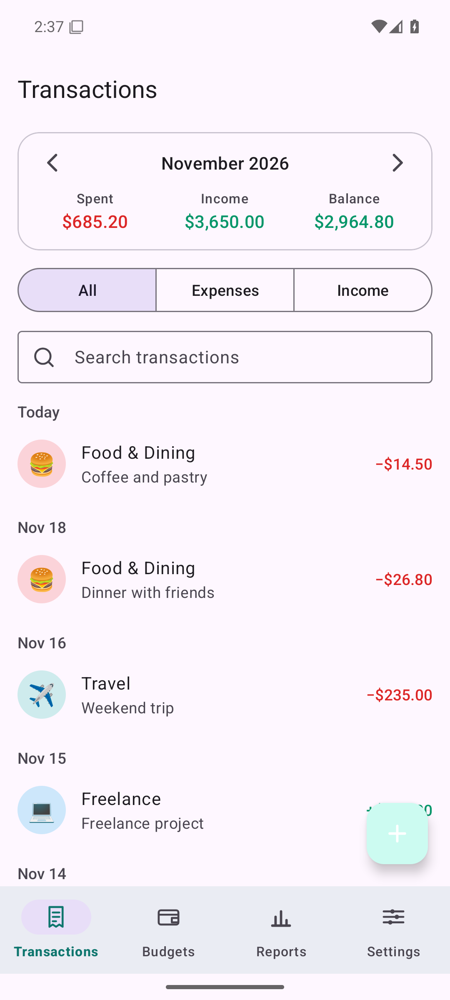
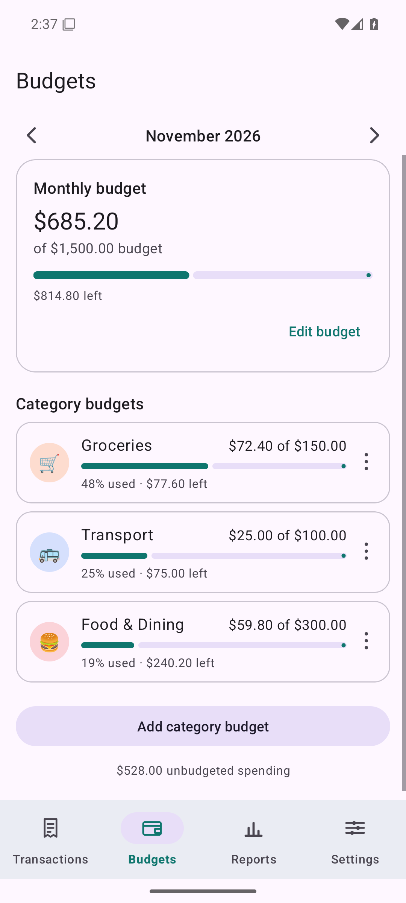
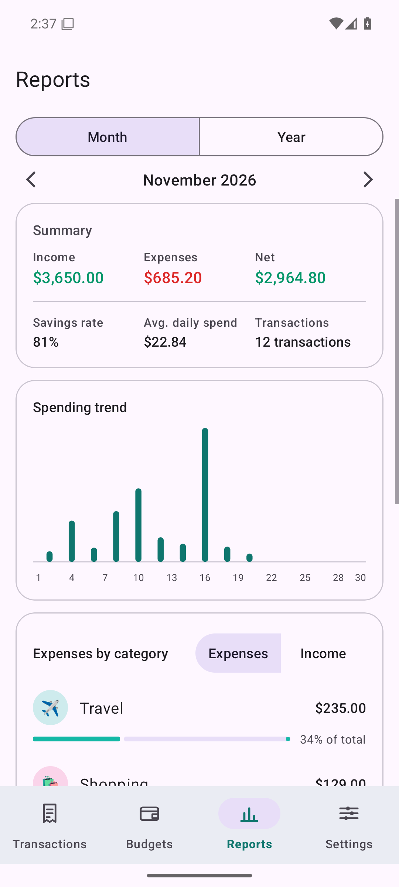
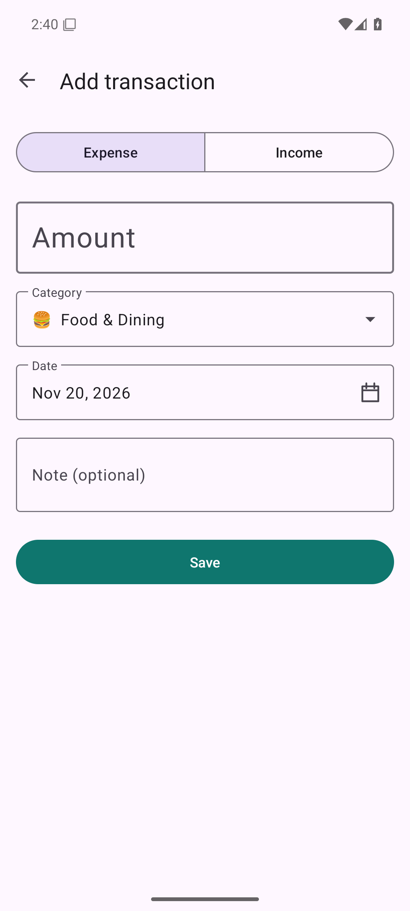
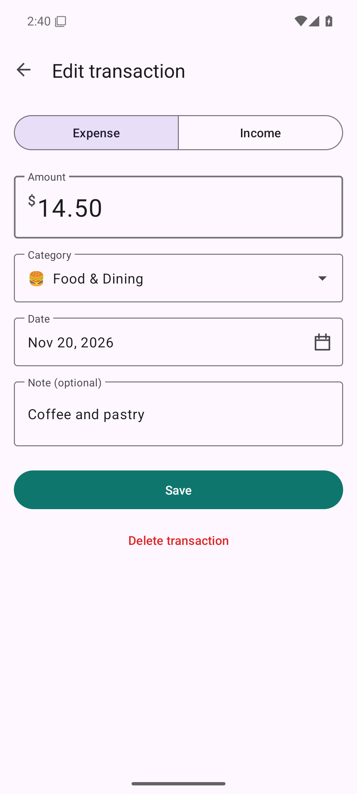
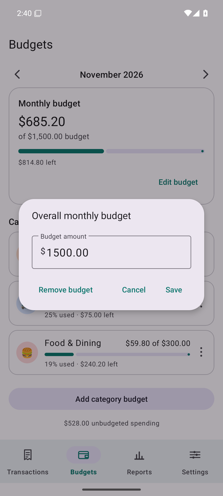
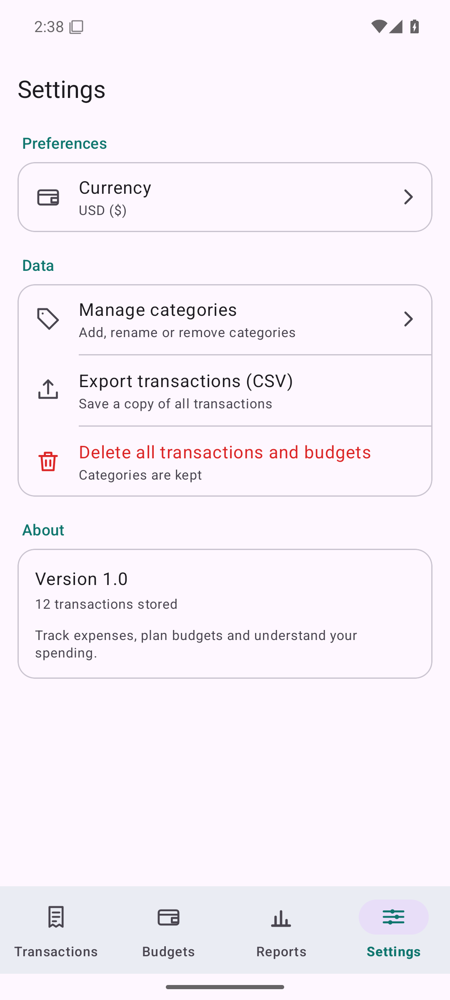
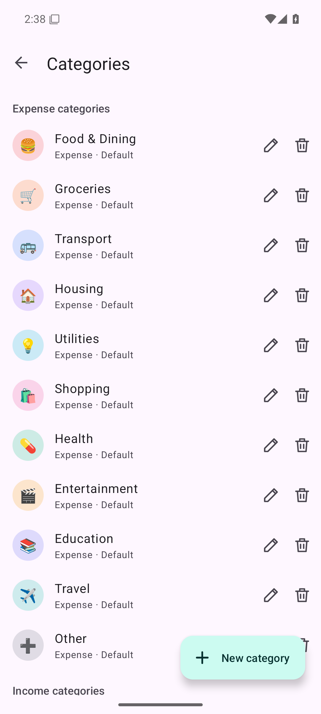

# Personal Expenses Tracker

An offline-first Android app for recording personal expenses and income, planning monthly budgets, and
understanding spending through reports. Built with Kotlin, Room and Material 3.



## Features

- **Transactions** — record expenses and income with amount, category, date and note. Every
  transaction can be edited or deleted; deletion from the list supports swipe-to-delete with undo.
- **Month overview** — navigate month by month and see spent, income and balance totals at a
  glance, with type filters (all / expenses / income) and a search box that matches notes and
  category names.
- **Budgets** — set one overall monthly budget and per-category budgets. Progress bars show how
  much of each budget has been used, with the remaining amount or an explicit over-budget state.
  Unbudgeted spending is surfaced so it is not forgotten.
- **Reports** — month or year view with income, expenses, net, savings rate, average daily spend,
  transaction count, a spending-trend bar chart and a category breakdown that can show expenses or
  income.
- **Categories** — 16 sensible defaults are seeded on first launch; add, rename, restyle (emoji and
  color) or delete categories. Categories referenced by transactions are protected from deletion.
- **Settings** — choose the display currency (30 common currencies), export all transactions to CSV
  through the system file picker, or delete all transactions and budgets while keeping categories.
- **Offline and private** — all data lives in a local Room database; the app requests no permissions.

## Screenshots

| Transactions | Budgets | Reports |
| --- | --- | --- |
|  |  |  |

| Add transaction | Edit transaction | Budget editor |
| --- | --- | --- |
|  |  |  |

| Settings | Categories |
| --- | --- |
|  |  |

The screenshots use demo data seeded into a debug build for illustration; a fresh install starts
empty with the default category set.

## Tech stack

| Area | Choice |
| --- | --- |
| Language | Kotlin 2.2.21 |
| Build | Gradle 8.14.3 (wrapper), Android Gradle Plugin 8.9.3, KSP 2.2.21-2.0.4 |
| SDK | `compileSdk`/`targetSdk` 35, `minSdk` 24 |
| UI | Material 3 (Views), ViewBinding, Navigation Component, RecyclerView |
| Persistence | Room 2.7.2 (entities, DAOs, KSP) |
| Async | Kotlin coroutines, Flow, `StateFlow` in view models |
| Testing | JUnit 4, Truth, `kotlinx-coroutines-test`, Room in-memory DB, Espresso + ActivityScenario |

## Architecture

```
UI (Activities / Fragments, ViewBinding)
        │  observes StateFlow
ViewModels (transactions, editor, budgets, reports, categories, settings)
        │  depends on the ExpenseDataSource interface
ExpenseRepository  ──►  Room DAOs  ──►  SQLite (personal_expenses.db)
```

- The UI layer renders immutable `UiState` snapshots emitted by view models; user actions go back
  to the view model, never straight to the database.
- `ExpenseDataSource` is the persistence contract. Room-backed `ExpenseRepository` implements it,
  and unit tests substitute a lightweight in-memory fake.
- Aggregations used by reports are pure functions in `ReportCalculator`, independent of Android, so
  the arithmetic is easy to test.

### Package map

```
com.personalexpenses.tracker
├── ExpenseTrackerApp.kt          Application: owns prefs + repository
├── data
│   ├── AppDatabase.kt            Room database, seeding callback
│   ├── Converters.kt             enum <-> TEXT
│   ├── SeedData.kt               16 default categories
│   ├── ExpenseDataSource.kt      persistence contract
│   ├── ExpenseRepository.kt      implementation
│   ├── entity/                   CategoryEntity, TransactionEntity, BudgetEntity
│   ├── dao/                      CategoryDao, TransactionDao, BudgetDao
│   └── model/                    TransactionType, TransactionRow, BudgetProgress, ...
├── ui
│   ├── MainActivity.kt           edge-to-edge host, toolbar, bottom navigation, FAB
│   ├── transactions/             list, adapter, view model
│   ├── addedit/                  add/edit form and view model
│   ├── budgets/                  budget screen and editor dialog
│   ├── reports/                  reports, category breakdown, custom TrendChartView
│   ├── categories/               category manager
│   ├── settings/                 currency, CSV export, destructive reset
│   └── common/                   extensions, category badge, category editor dialog
└── util                          Money, Dates, ReportCalculator, CsvExporter, Prefs
```

## Data model

| Table | Key columns | Notes |
| --- | --- | --- |
| `categories` | `id`, `name`, `type`, `colorHex`, `iconKey` | Unique `(name, type)`; names are trimmed and case-insensitively compared. |
| `transactions` | `id`, `amountCents`, `type`, `categoryId`, `date`, `note` | FK to `categories` with `RESTRICT`, so a used category cannot be deleted. Indexed on date/type/category. |
| `budgets` | `id`, `yearMonth`, `categoryId`, `amountCents` | Unique `(yearMonth, categoryId)`; `categoryId = 0` is the overall monthly budget. |

Conventions:

- Amounts are stored as `Long` **minor units** (cents) and formatted with `NumberFormat`; floating
  point never reaches the database.
- Dates are epoch milliseconds at local midnight; months are compared using the integer `yyyyMM`
  key, which sorts naturally.
- Money input accepts `1,234.56`, `1234,56`, currency symbols and extra spaces, and is rejected
  when invalid or malformed (for example `1.2.3.4`).
- The Room schema is exported to `app/schemas/com.personalexpenses.tracker.data.AppDatabase/` so
  future schema changes can ship tested migrations.

## Build and run

Requirements: JDK 17+ (tested on Temurin 21), Android SDK platform 35 with build-tools 35.0.1, and
an emulator or device running Android 7.0 (API 24) or newer.

Point the build at your SDK with `ANDROID_HOME`, or create a `local.properties` containing
`sdk.dir=/path/to/android-sdk`.

```bash
./gradlew :app:assembleDebug             # debug APK
./gradlew :app:testDebugUnitTest         # JVM unit tests
./gradlew :app:connectedDebugAndroidTest # instrumented tests (device/emulator required)
./gradlew :app:assembleRelease           # unsigned release build
adb install -r app/build/outputs/apk/debug/app-debug.apk
```

The Gradle wrapper downloads Gradle 8.14.3 on first use.

## Testing and verification

| Suite | Tests | Covers |
| --- | --- | --- |
| `MoneyTest` | 13 | parsing separators/symbols, rounding, zero-decimal currencies, overflow rejection, formatting |
| `DatesTest` | 10 | month keys/ranges, year boundaries, leap years, day headers |
| `ReportCalculatorTest` | 10 | totals, savings rate, category breakdown, daily/monthly trend, averages |
| `BudgetProgressTest` | 4 | remaining amounts, progress clamping, over-budget, zero budget |
| `CsvExporterTest` | 3 | header, quoting/escaping, empty export |
| `TransactionsViewModelTest` | 5 | month navigation, totals, filters, search, delete/undo |
| `AddEditTransactionViewModelTest` | 9 | defaults, validation, create/update, type switch, inline category creation |
| `BudgetsViewModelTest` | 4 | budget/spend combination, set/remove, month changes |
| `ReportsViewModelTest` | 4 | monthly/yearly aggregation, breakdown toggle, period navigation |
| `CategoriesViewModelTest` | 5 | grouping, create/update, duplicate handling, deletion rules |
| **Unit total** | **67** | |
| `DatabaseTest` | 6 | joins, filtered queries, SQL aggregates, budget uniqueness, FK enforcement |
| `ExpenseRepositoryTest` | 9 | CRUD, undo restore, aggregates, budgets, category rules, delete-all |
| `TransactionFlowTest` | 6 | add/edit/delete/undo through the UI, validation, filters and search |
| `BudgetAndReportFlowTest` | 6 | overall/category budget dialogs, progress, over-budget, report totals and periods |
| `NavigationAndSettingsTest` | 4 | bottom navigation, settings, category creation, FAB/back behavior |
| **Instrumented total** | **31** | |

Latest verification results on a clean Android 15 (API 35) emulator:

- `./gradlew :app:testDebugUnitTest` — **67 tests, 0 failures**
- `./gradlew :app:connectedDebugAndroidTest` — **31 tests, 0 failures**
- `./gradlew :app:lintDebug` — **0 errors** (warnings are dependency-update suggestions and
  unused-resource hints)
- `./gradlew :app:assembleRelease` — succeeds, producing `app-release-unsigned.apk`
- Manual smoke test — installed and launched on the emulator; the screens above were captured from
  the running app with demo data.

## Design decisions

- **Cents, not doubles.** All amounts are integer minor units; formatting/parsing is centralized in
  `Money`, and extra decimal input is rounded half-up.
- **Interface-backed repository.** Unit tests run without Android because view models depend on
  `ExpenseDataSource`; the fake mirrors the filtering/aggregation semantics of the Room queries.
- **Server-side aggregation.** Totals and category sums are computed in SQL; the reports view model
  loads the period once and derives slices/trends with pure Kotlin functions.
- **No third-party chart library.** `TrendChartView` is a small custom `View` using Canvas, which
  keeps the dependency surface and APK small.
- **Explicit edge-to-edge handling.** Insets are applied to the activity root so content stays clear
  of system bars and the keyboard on API 24 through 35.
- **CSV through the Storage Access Framework.** The export uses `CreateDocument`, so the app needs no
  storage permission and the user chooses the destination.

## Known limitations

- One display currency at a time; changing it changes formatting but does not convert stored values.
- Budgets are per month and are not copied into new months automatically.
- No cloud sync, backup, recurring transactions or notifications; CSV export is the portability path.
- The release APK is unsigned; sign it with your own keystore before distribution.

## Acceptance criteria

- [x] Add, edit and delete expense and income transactions with amount/category/date/note validation.
- [x] Persist all data in a local Room database with seeded default categories and referential integrity.
- [x] Month-by-month transaction list with totals, type filters, search, swipe-to-delete and undo.
- [x] Monthly budgeting: overall and per-category budgets, live progress, remaining/over-budget states.
- [x] Reporting: monthly and yearly totals, savings rate, average daily spend, category breakdown and trend chart.
- [x] Category management with duplicate protection and deletion guards.
- [x] Settings: currency selection, CSV export and a confirmed destructive reset.
- [x] Unit and instrumented test suites pass; lint reports no errors; debug and release builds succeed.
- [x] Verified on an Android 15 (API 35) emulator by automated tests and manual screenshots.

## License

This project is provided for personal use and learning. Add your preferred license before publishing.
